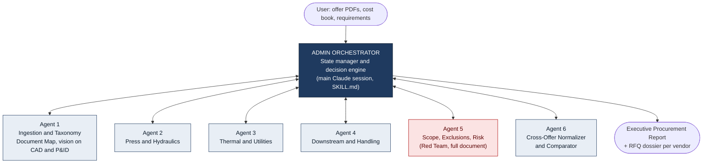
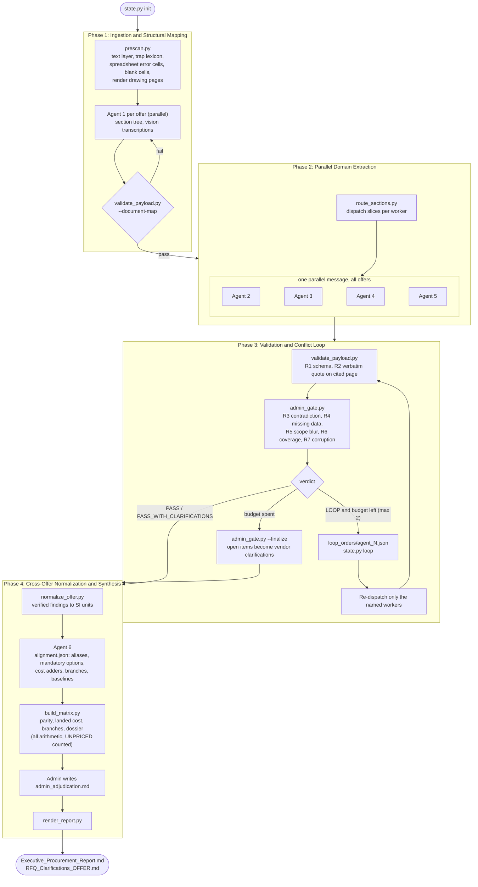
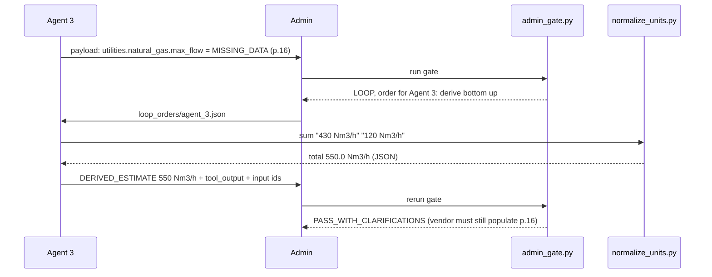

# Offer Agentic System

A Claude Code skill that audits, normalizes and compares industrial capital equipment offers (extrusion lines, presses, furnaces, handling systems) with a 7-agent hub-and-spoke architecture.

## Use

Open this repository in Claude Code and ask:

```
/offer-audit Audit and compare offers/omav_sms.pdf (OMAV/SMS) and offers/danieli.pdf (Danieli Breda). Cost book: inputs/cost_book.json. Requirement: must accept existing 7" tooling from an 1800 MT press.
```

The main session becomes the Admin orchestrator. It dispatches six subagents (`.claude/agents/offer-*.md`), gates their output with deterministic scripts, loops failed work back at most twice, and writes `offer_audit_runs/<run>/report/Executive_Procurement_Report.md` plus one vendor-ready RFQ clarification file per offer.

## Architecture

### Topology (hub and spoke)

Workers never talk to each other. Every payload, rejection and loop routes through the Admin.



### Workflow (deterministic state machine)

Agents read and judge. Scripts verify and calculate. State is saved to `state.json` after every phase.



### Loop example: blank utility table (rule R4)



### Roster

| Agent | Role | Subagent | Spec |
|---|---|---|---|
| Admin | Orchestrator and decision engine | main session | `.claude/skills/offer-audit/SKILL.md` |
| 1 | Ingestion and taxonomy parser (vision for CAD and P&ID) | `offer-ingestion-parser` | `agents/agent-1-ingestion.md` |
| 2 | Press and hydraulics | `offer-press-hydraulics` | `agents/agent-2-press-hydraulics.md` |
| 3 | Thermal, combustion, utilities | `offer-thermal-utilities` | `agents/agent-3-thermal-utilities.md` |
| 4 | Downstream and handling | `offer-downstream-handling` | `agents/agent-4-downstream-handling.md` |
| 5 | Scope, exclusions, risk (red team) | `offer-risk-redteam` | `agents/agent-5-risk-redteam.md` |
| 6 | Cross-offer normalizer and comparator | `offer-normalizer-comparator` | `agents/agent-6-normalizer-comparator.md` |

Deterministic layer (`.claude/skills/offer-audit/scripts/`, Python standard library, poppler-utils):

| Script | Phase | Purpose |
|---|---|---|
| `state.py` | all | Phase state machine, loop budget, resumability |
| `prescan.py` | 1 | Text layer, trap lexicon scan, corrupted cells, blank cells, vision queue renders |
| `merge_document_map.py` | 1 | Merge sharded Agent 1 output on long documents |
| `route_sections.py` | 2 | Slice the Document Map into per-worker dispatch files |
| `validate_payload.py` | 1, 3 | Schema check and verbatim evidence verification against page text |
| `admin_gate.py` | 3 | Rules R1 to R7: schema, evidence, contradiction, missing data, scope blur, coverage, corruption |
| `normalize_units.py` | 3, 4 | SI conversion, sums and per-tonne figures for derivations |
| `normalize_offer.py` | 4 | Verified findings to SI records |
| `build_matrix.py` | 4 | Parity table, landed cost, branches, dossier. All arithmetic lives here |
| `render_report.py` | 4 | Executive report and RFQ dossiers |

## Requirements

* Claude Code (subagents, Read tool with PDF page support)
* Python 3.10 or newer, `poppler-utils` (`pdftotext`, `pdftoppm`, `pdfinfo`, `pdfimages`)
* Optional: `jsonschema` (built-in fallback validator otherwise), `reportlab` (tests only)

## Test

```bash
python3 -m unittest discover -s .claude/skills/offer-audit/tests -v
```

The test builds two synthetic offers seeded with the reference trap patterns (7 inch promise vs optional container, blank utility gas flow, pneumatic vs electric shuttle, `#VALORE!`, excluded cabling, buyer-supplied fencing, a fabricated quote) and runs the full deterministic pipeline including a rework loop.

## Cost book

Copy `.claude/skills/offer-audit/config/cost_book.example.json`, fill real figures with their source. Missing entries are reported as UNPRICED. The system never invents prices.
